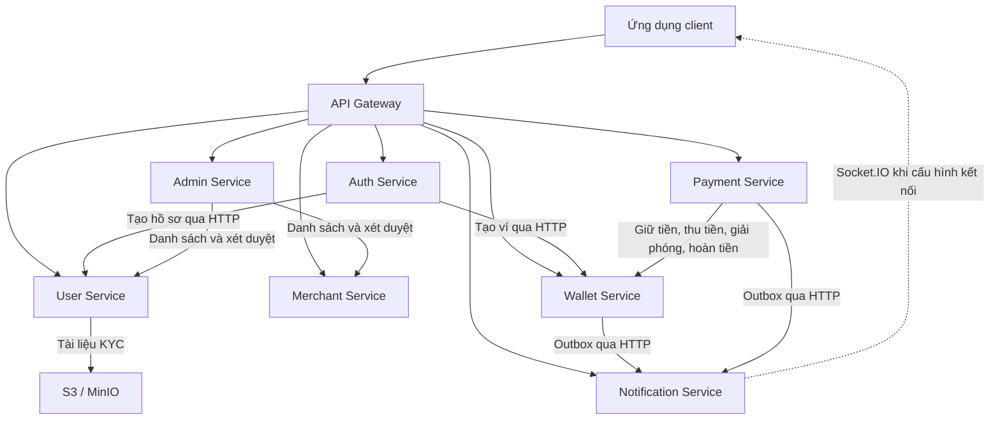

# Tổng quan và các chức năng hiện tại của backend FinVault

Ngày tổng hợp: **04/10/2026**.

Tài liệu được tổng hợp từ mã nguồn đang có trong thư mục dự án, bao gồm các thay đổi cục bộ tại thời điểm đọc. Căn cứ chính là route, controller, service, Prisma schema và cấu hình triển khai. “Đã có” trong tài liệu nghĩa là đã có mã xử lý; lần tổng hợp này không khởi chạy hệ thống hoặc chạy lại bộ kiểm thử để xác nhận trạng thái vận hành.

## 1. Tổng quát về dự án

### 1.1. Mục đích và phạm vi

Backend sử dụng tên **FinVault** trong cấu hình container và sự kiện. Đây là hệ thống backend cho ứng dụng ví điện tử và thanh toán, tổ chức theo kiến trúc **microservices**. Các nhóm nghiệp vụ chính gồm:

- Đăng ký tài khoản, đăng nhập và quản lý phiên.
- Quản lý hồ sơ cá nhân và xác minh danh tính qua hồ sơ KYC.
- Đăng ký, quản lý và xét duyệt đối tác kinh doanh (Merchant).
- Quản lý số dư ví, giữ tiền, chuyển tiền và lịch sử giao dịch.
- Điều phối thanh toán, hủy giao dịch và hoàn tiền.
- Lưu trữ, tra cứu và gửi thông báo thời gian thực.
- Quản trị, xét duyệt và ghi nhật ký thao tác quản trị viên.

Hệ thống có hai vai trò tài khoản trong Auth: `USER` và `ADMIN`. Merchant là hồ sơ kinh doanh gắn với tài khoản thông qua `ownerId`; hiện không có vai trò `MERCHANT` riêng trong enum quyền của Auth.

Các loại thanh toán `CARD_TOPUP`, `BUS_TICKET`, `MOVIE_TICKET`, `TRAIN_TICKET`, `WALLET_TRANSFER` đã được khai báo. Tuy nhiên, mã nguồn hiện tại xử lý chúng qua luồng thanh toán ví chung; chưa thấy các module tích hợp nhà cung cấp thẻ, đặt vé hoặc phát hành vé tương ứng.

### 1.2. Kiến trúc hệ thống

Hệ thống gồm **1 API Gateway và 7 dịch vụ nghiệp vụ**. Client gọi REST API qua Gateway; Gateway xác thực và chuyển yêu cầu đến dịch vụ phụ trách.

| Thành phần | Cổng cấu hình | Tiền tố REST API | Trách nhiệm chính |
| --- | --- | --- | --- |
| API Gateway | 3000 | `/api/*` | Xác thực JWT, phân quyền route quản trị, định tuyến request |
| Auth Service | 3001 | `/api/auth` | Tài khoản, mật khẩu, token và phiên đăng nhập |
| User Service | 3002 | `/api/users` | Hồ sơ cá nhân, tài liệu và trạng thái KYC |
| Merchant Service | 3003 | `/api/merchants` | Hồ sơ đối tác, trạng thái xét duyệt và sự kiện Merchant |
| Wallet Service | 3004 | `/api/wallets` | Ví, số dư, khoản giữ tiền và sổ giao dịch |
| Payment Service | 3005 | `/api/payments` | Checkout, xác nhận, hoàn tiền, hủy và hết hạn thanh toán |
| Notification Service | 3006 | `/api/notifications` | Thông báo, trạng thái đọc và Socket.IO |
| Admin Service | 3007 | `/api/admin` | Dashboard, duyệt KYC/Merchant và nhật ký quản trị |

Các cổng trên là cấu hình của dự án, không có nghĩa tất cả đều được công khai ra máy host. Trong Docker Compose gốc, Gateway và Payment có ánh xạ cổng host; các dịch vụ nghiệp vụ còn lại dùng `expose`.



Mỗi dịch vụ nghiệp vụ có Prisma schema và database riêng. `init-db.sql` tạo bảy database trên cùng một PostgreSQL instance: `auth_service`, `user_service`, `merchant_service`, `wallet_service`, `payment_service`, `notification_service`, `admin_service`. Dữ liệu liên dịch vụ được tham chiếu bằng ID và trao đổi qua API hoặc sự kiện.

Ngoài HTTP, dự án có mã RabbitMQ cho consumer đăng ký người dùng, publisher sự kiện Merchant và consumer thông báo. Các thành phần này cần broker, cấu hình và tiến trình worker tương ứng; chưa được triển khai đầy đủ trong Docker Compose gốc.

### 1.3. Công nghệ sử dụng

| Nhóm | Công nghệ và vai trò |
| --- | --- |
| Ngôn ngữ, runtime | TypeScript, Node.js; `tsx` và `nodemon` phục vụ chạy/phát triển |
| HTTP API | Express; Gateway dùng `http-proxy-middleware` |
| Cơ sở dữ liệu | PostgreSQL 16 theo Docker Compose, Prisma ORM dòng 6 |
| Xác thực | JWT, bcrypt, refresh token và cookie HTTP-only |
| Kiểm tra đầu vào | Zod, middleware kiểm tra request |
| Upload KYC | Multer nhận file, Sharp kiểm tra và chuẩn hóa ảnh |
| Lưu trữ đối tượng | AWS SDK S3; có cấu hình MinIO cho môi trường kiểm thử |
| Thông báo thời gian thực | Socket.IO |
| Sự kiện và tác vụ nền | RabbitMQ qua `amqplib`, outbox lưu trong database, `node-cron` |
| Middleware HTTP | CORS, Helmet, Morgan và request ID tại các thành phần có cấu hình |
| Triển khai | Dockerfile từng thành phần, Docker Compose |
| Kiểm thử hiện có | Node test runner, Supertest, integration test và bộ nghiệm thu qua trình duyệt |

### 1.4. Tổ chức mã nguồn và dữ liệu

```text
gateway/                 API Gateway
services/
  auth-service/          Xác thực và phiên đăng nhập
  user-service/          Hồ sơ cá nhân, KYC, consumer đăng ký
  merchant-service/      Đối tác, outbox và publisher sự kiện
  wallet-service/        Ví và sổ giao dịch
  payment-service/       Điều phối thanh toán
  notification-service/  Thông báo và Socket.IO
  admin-service/         Quản trị và audit log
tests/acceptance/        Kịch bản nghiệm thu tích hợp
docker-compose.yml      Cấu hình container chính
init-db.sql              Khởi tạo các database
```

Phần lớn dịch vụ chia mã thành `routes`, `controllers`, `services`, `middlewares`, `validations`, `config` và `prisma`. User/Merchant có thêm thư mục `events` cho xử lý sự kiện.

| Dịch vụ | Các model dữ liệu chính |
| --- | --- |
| Auth | `User`, `Session` |
| User | `User`, `ConsumedEvent`, `StorageCleanup` |
| Merchant | `Merchant`, `MerchantOutboxEvent` |
| Wallet | `Wallet`, `WalletHold`, `LedgerEntry`, `WalletOutboxEvent` |
| Payment | `Payment`, `PaymentHistory`, `OutboxEvent` |
| Notification | `Notification` |
| Admin | `AdminAuditLog` |

Nguồn: [Docker Compose](docker-compose.yml), [khởi tạo database](init-db.sql), [Gateway](gateway/src/app.ts) và các file `services/*/prisma/schema.prisma`.

## 2. Các chức năng đã có hiện tại

### 2.1. Xác thực và quản lý phiên — Auth Service

- **Đăng ký tài khoản:** nhận username, email, mật khẩu, họ và tên; kiểm tra trùng username/email; băm mật khẩu bằng bcrypt.
- **Khởi tạo dữ liệu liên quan:** sau khi tạo tài khoản, gọi User Service để tạo hồ sơ và Wallet Service để tạo ví. Hai lời gọi chạy song song; nếu đồng bộ thất bại, Auth ghi log và vẫn giữ tài khoản đã tạo.
- **Đăng nhập:** xác thực bằng username và mật khẩu, trả thông tin tài khoản và access token JWT có thời hạn 15 phút.
- **Quản lý refresh token:** thời hạn 14 ngày, lưu bản băm SHA-256 trong bảng `Session`; token gốc được gửi bằng cookie HTTP-only.
- **Làm mới phiên:** cấp access token mới và xoay vòng refresh token bằng cách xóa session cũ, tạo session mới trong transaction.
- **Đăng xuất:** thu hồi session theo refresh token và xóa cookie.
- **Giới hạn tần suất:** đăng ký và đăng nhập có limiter riêng, hiện cấu hình 30 yêu cầu trong 15 phút.

| Method | API | Chức năng |
| --- | --- | --- |
| POST | `/api/auth/signup` | Đăng ký |
| POST | `/api/auth/signin` | Đăng nhập |
| POST | `/api/auth/refresh` | Làm mới token |
| POST | `/api/auth/signout` | Đăng xuất |

Nguồn: [AuthService](services/auth-service/src/services/authService.ts), [Auth Controller](services/auth-service/src/controllers/authController.ts).

### 2.2. Hồ sơ người dùng và KYC — User Service

- **Tạo hồ sơ người dùng từ lời gọi nội bộ**, liên kết với tài khoản Auth bằng `authUserId`.
- **Xem và cập nhật hồ sơ cá nhân:** họ tên đầy đủ, số điện thoại, địa chỉ; hỗ trợ tra cứu bằng ID hồ sơ hoặc Auth ID.
- **Danh sách người dùng cho quản trị/nội bộ:** phân trang, tìm theo email/họ tên và lọc trạng thái KYC.
- **Nộp hồ sơ KYC:** nhận số giấy tờ và một ảnh JPEG/PNG tối đa 5 MiB; kiểm tra nội dung ảnh, chuẩn hóa về JPEG và lưu vào S3/MinIO.
- **Truy cập tài liệu KYC có kiểm soát:** sau khi kiểm tra quyền, cấp URL có chữ ký hết hạn sau 60 giây; response hồ sơ thông thường không trả object key lưu trữ.
- **Quản lý trạng thái KYC:** `NONE`, `PENDING`, `APPROVED`, `REJECTED`; nộp hồ sơ chuyển sang `PENDING`, quản trị viên duyệt hoặc từ chối. Hồ sơ đã duyệt phải bị thu hồi/từ chối trước khi nộp lại.
- **Kiểm soát cập nhật đồng thời:** sử dụng trường `version` cho các thao tác KYC để phát hiện hồ sơ đã thay đổi.
- **Dọn file lưu trữ:** có bảng công việc và tác vụ nền xử lý ảnh cũ hoặc ảnh không còn được tham chiếu.
- **Tiếp nhận sự kiện `user.registered`:** có consumer tạo hồ sơ, chống xử lý trùng theo event ID/payload hash, retry và hàng đợi lỗi để xử lý lại.

| Method | API | Chức năng |
| --- | --- | --- |
| POST | `/api/users` | Tạo hồ sơ, dành cho nội bộ |
| GET | `/api/users` | Danh sách người dùng cho quản trị/nội bộ |
| GET / PUT | `/api/users/:id` | Xem / sửa hồ sơ |
| GET / PUT | `/api/users/by-auth/:authUserId` | Xem / sửa theo Auth ID |
| POST | `/api/users/:id/kyc` | Nộp tài liệu KYC |
| GET | `/api/users/:id/kyc/document` | Lấy URL xem tài liệu KYC |
| POST | `/api/users/by-auth/:authUserId/kyc` | Nộp KYC theo Auth ID |
| GET | `/api/users/by-auth/:authUserId/kyc/document` | Lấy URL tài liệu theo Auth ID |
| PATCH | `/api/users/:id/kyc-status` | Cập nhật trạng thái KYC cho quản trị/nội bộ |

Nguồn: [User Controller](services/user-service/src/controllers/userController.ts), [xử lý KYC](services/user-service/src/services/kyc.service.ts), [consumer đăng ký](services/user-service/src/events/consumer.ts).

### 2.3. Quản lý đối tác — Merchant Service

- **Đăng ký đối tác:** lưu tên doanh nghiệp/cửa hàng, mã số thuế và tài khoản ngân hàng nếu có; chủ sở hữu lấy từ danh tính đã xác thực. `ownerId` là duy nhất trong schema.
- **Xem đối tác của bản thân:** endpoint `/me` trả hồ sơ của người đang đăng nhập hoặc `null` nếu chưa đăng ký.
- **Xem và sửa hồ sơ:** áp dụng kiểm tra chính chủ, quản trị hoặc lời gọi nội bộ.
- **Quản trị danh sách:** phân trang, tìm theo tên doanh nghiệp và lọc trạng thái.
- **Xét duyệt:** đăng ký mới có trạng thái `PENDING`; hỗ trợ `PENDING → APPROVED/REJECTED`, `APPROVED → REJECTED`, `REJECTED → PENDING`.
- **Kiểm tra hoạt động:** trả `active: true` khi Merchant ở trạng thái `APPROVED`; endpoint này không trả thông tin tài khoản ngân hàng.
- **Phát sự kiện:** ghi `merchant.registered` và `merchant.status_updated` vào outbox cùng transaction với thay đổi dữ liệu; worker phát RabbitMQ, có retry, bảo toàn thứ tự theo Merchant và xử lý lại event `FAILED`.

| Method | API | Chức năng |
| --- | --- | --- |
| POST | `/api/merchants/register` | Đăng ký đối tác |
| GET | `/api/merchants/me` | Hồ sơ đối tác của người đang đăng nhập |
| GET | `/api/merchants` | Danh sách cho quản trị/nội bộ |
| GET / PUT | `/api/merchants/:id` | Xem / sửa hồ sơ |
| PATCH | `/api/merchants/:id/status` | Đổi trạng thái cho quản trị/nội bộ |
| GET | `/api/merchants/:id/active` | Kiểm tra trạng thái hoạt động |

Nguồn: [Merchant Controller](services/merchant-service/src/controllers/merchantController.ts), [nghiệp vụ Merchant](services/merchant-service/src/services/merchant.service.ts), [outbox Merchant](services/merchant-service/src/events/outbox.ts).

### 2.4. Ví điện tử và sổ giao dịch — Wallet Service

- **Tạo và đọc ví:** có mô hình chủ ví `USER`, `MERCHANT`, `SYSTEM`; mặc định tiền tệ là VND. Tạo lại ví đã tồn tại trả về ví hiện có.
- **Tra cứu số dư:** trả tổng số dư (`balance`), số dư đang giữ (`heldBalance`) và số dư khả dụng (`availableBalance = balance - heldBalance`).
- **Giữ tiền (`hold`):** kiểm tra trạng thái ví, số dư khả dụng, số tiền và hạn giữ tiền trước khi tạo khoản giữ.
- **Thu tiền đã giữ (`capture`):** chuyển tiền từ ví người dùng sang ví hệ thống và đánh dấu khoản giữ đã thu.
- **Giải phóng tiền (`release`):** hủy khoản giữ chưa thu; tác vụ nền quét khoản giữ hết hạn mỗi 10 giây.
- **Chuyển tiền giữa người dùng:** thực hiện chuyển từ ví người gửi sang ví người nhận, từ chối chuyển cho chính mình.
- **Cộng/trừ tiền:** có nghiệp vụ `credit` và `debit`, sử dụng ví hệ thống làm tài khoản đối ứng; đây là thao tác số dư nội bộ, chưa phải tích hợp nạp/rút qua ngân hàng.
- **Ghi sổ giao dịch hai chiều:** mỗi lần chuyển tiền tạo một dòng `DEBIT` và một dòng `CREDIT` có chung `transactionId`, kèm số dư sau giao dịch.
- **Xử lý yêu cầu lặp:** dùng `referenceId` để nhận diện một số thao tác đã thực hiện và trả kết quả replay.
- **Tra cứu lịch sử:** có phân trang, khoảng thời gian, số tiền, chiều giao dịch, loại giao dịch, số dư sau giao dịch và ghi chú.
- **Quản trị ví:** khóa/mở khóa, điều chỉnh số dư có lý do, danh sách ví lọc theo chủ sở hữu/loại/trạng thái.
- **Outbox biến động số dư:** ghi sự kiện trong transaction và có scheduler gửi sang Notification Service; phần ánh xạ loại thông báo còn bất nhất, xem mục 3.

| Method | API | Chức năng |
| --- | --- | --- |
| POST | `/api/wallets` | Tạo ví |
| GET | `/api/wallets/:userId/balance` | Xem số dư |
| POST | `/api/wallets/:userId/hold` | Giữ tiền |
| POST | `/api/wallets/:userId/capture` | Thu tiền đã giữ |
| POST | `/api/wallets/:userId/release` | Giải phóng khoản giữ |
| POST | `/api/wallets/:userId/transfer` | Chuyển tiền giữa ví người dùng |
| POST | `/api/wallets/:userId/credit` | Cộng tiền |
| POST | `/api/wallets/:userId/debit` | Trừ tiền |
| GET | `/api/wallets/:userId/history` | Lịch sử ví |
| GET | `/api/wallets/admin` | Danh sách ví cho quản trị |
| POST | `/api/wallets/admin/:userId/lock` | Khóa ví |
| POST | `/api/wallets/admin/:userId/unlock` | Mở khóa ví |
| POST | `/api/wallets/admin/:userId/adjust` | Điều chỉnh số dư |

API `GET /api/wallets/admin/reconciliation` đã được khai báo nhưng hàm xử lý còn trả `NOT_IMPLEMENTED`, nên chưa tính là chức năng đối soát hoàn thành.

Nguồn: [WalletService](services/wallet-service/src/services/wallet.service.ts), [route ví](services/wallet-service/src/routes/wallet.routes.ts), [route quản trị ví](services/wallet-service/src/routes/admin.routes.ts).

### 2.5. Điều phối thanh toán — Payment Service

- **Checkout:** nhận số tiền, loại thanh toán, tham chiếu nghiệp vụ, `callbackTopic` và `idempotencyKey`; gọi Wallet giữ tiền trong 15 phút, sau đó lưu giao dịch `PENDING` và lịch sử trạng thái.
- **Nhận diện checkout lặp:** nếu đã có `idempotencyKey`, trả bản ghi thanh toán hiện có.
- **Xác nhận thanh toán:** endpoint nội bộ gọi Wallet capture khoản giữ; khi thành công chuyển thành `SUCCESS` và ghi outbox.
- **Xử lý lỗi và bù trừ:** có lời gọi giải phóng khoản giữ khi lưu checkout lỗi, hoặc cộng trả tiền nếu capture thành công nhưng cập nhật Payment thất bại. Đây là mã bù trừ theo luồng xử lý, không phải một transaction nguyên tử giữa hai database.
- **Hoàn tiền:** endpoint nội bộ cho giao dịch `SUCCESS`, gọi Wallet cộng tiền và chuyển sang `REFUNDED`.
- **Hủy thanh toán:** với giao dịch `PENDING`, gọi giải phóng khoản giữ và chuyển sang `CANCELLED`.
- **Xử lý hết hạn:** scheduler chạy mỗi 5 phút, tìm thanh toán chờ đã quá hạn, giải phóng khoản giữ và ghi trạng thái `EXPIRED`.
- **Tra cứu:** xem chi tiết kèm lịch sử thay đổi trạng thái; danh sách có bộ lọc `userId`, `type`, `status`. Danh sách hiện chưa có phân trang thực tế.
- **Gửi kết quả thanh toán:** scheduler outbox gọi Notification Service qua HTTP mỗi 5 giây, có retry/backoff và đánh dấu `FAILED` khi vượt ngưỡng hoặc gặp lỗi client.

Các trạng thái đã khai báo và sử dụng: `PENDING`, `SUCCESS`, `FAILED`, `REFUNDED`, `CANCELLED`, `EXPIRED`.

| Method | API | Chức năng |
| --- | --- | --- |
| POST | `/api/payments/checkout` | Khởi tạo thanh toán |
| POST | `/api/payments/:id/confirm` | Xác nhận, yêu cầu khóa nội bộ |
| POST | `/api/payments/:id/refund` | Hoàn tiền, yêu cầu khóa nội bộ |
| POST | `/api/payments/:id/cancel` | Hủy giao dịch chờ |
| GET | `/api/payments/:id` | Chi tiết và lịch sử trạng thái |
| GET | `/api/payments` | Danh sách có bộ lọc |

Nguồn: [PaymentService](services/payment-service/src/services/payment.service.ts), [Payment Controller](services/payment-service/src/controllers/payment.controller.ts), [scheduler Payment](services/payment-service/src/services/outbox.scheduler.ts).

### 2.6. Thông báo — Notification Service

- **Tạo và lưu thông báo:** API nội bộ nhận người dùng, loại và nội dung thông báo, lưu PostgreSQL.
- **Danh sách thông báo cá nhân:** sắp xếp mới nhất trước, có phân trang, tổng số và `unreadCount` được đếm từ database.
- **Đánh dấu đã đọc:** hỗ trợ từng thông báo hoặc toàn bộ thông báo của người dùng.
- **Kiểm tra chính chủ:** người dùng chỉ xem và đánh dấu thông báo của mình, kể cả tài khoản có vai trò ADMIN.
- **Thông báo thời gian thực:** Socket.IO xác thực JWT từ handshake, đưa socket vào phòng `user:<userId>` và phát `notification:new` khi tạo thông báo.
- **Tiếp nhận RabbitMQ khi được cấu hình:** có consumer cho các exchange `wallet.events`, `payment.events`, `kyc.events` với payload thông báo phù hợp.
- **Các loại thông báo hỗ trợ:** thanh toán thành công/thất bại/hoàn tiền/hủy, ví được cộng/trừ tiền, KYC được duyệt/từ chối và Merchant được duyệt/từ chối. Có enum tiếp nhận không đồng nghĩa tất cả luồng nguồn đã tự phát các loại này.

| Method | API | Chức năng |
| --- | --- | --- |
| POST | `/api/notifications` | Tạo thông báo, yêu cầu khóa nội bộ |
| GET | `/api/notifications/:userId` | Danh sách và số chưa đọc |
| PATCH | `/api/notifications/:id/read` | Đánh dấu một thông báo đã đọc |
| PATCH | `/api/notifications/:userId/read-all` | Đánh dấu tất cả đã đọc |

Nguồn: [Notification Controller](services/notification-service/src/controllers/notificationController.ts), [khởi tạo Socket.IO](services/notification-service/src/server.ts), [RabbitMQ consumer](services/notification-service/src/services/rabbitmqConsumer.ts).

### 2.7. Quản trị hệ thống — Admin Service

- **Dashboard:** đã có endpoint tổng hợp số người dùng, phân bố trạng thái KYC, số Merchant, phân bố trạng thái Merchant và hoạt động quản trị. Cách lấy số liệu hiện có bất nhất về giới hạn phân trang, xem mục 3.
- **Quản lý KYC:** danh sách có tìm kiếm, phân trang, lọc trạng thái; duyệt/từ chối thông qua User Service.
- **Quản lý Merchant:** danh sách có tìm kiếm, phân trang, lọc trạng thái; duyệt/từ chối thông qua Merchant Service.
- **Ghi nhật ký xét duyệt:** lưu admin thực hiện, hành động, đối tượng, ghi chú và thời gian vào `AdminAuditLog`.
- **Tra cứu nhật ký:** lọc theo hành động, admin, đối tượng; có phân trang.
- **Thống kê hoạt động quản trị:** tổng số log, số hành động trong ngày và 5 hoạt động gần nhất.
- **Xử lý lỗi audit riêng:** nếu thay đổi trạng thái thành công nhưng lưu audit thất bại, trả cảnh báo `AUDIT_LOG_FAILED`.

| Method | API | Chức năng |
| --- | --- | --- |
| GET | `/api/admin/dashboard` hoặc `/api/admin/dashboard/stats` | Tổng hợp dashboard |
| GET | `/api/admin/kyc` | Danh sách hồ sơ KYC |
| POST | `/api/admin/kyc/:userId/review` | Duyệt/từ chối KYC |
| PATCH | `/api/admin/kyc/:userId/status` | Đường dẫn thay thế cho xét duyệt KYC |
| GET | `/api/admin/merchants` | Danh sách Merchant |
| POST | `/api/admin/merchants/:merchantId/review` | Duyệt/từ chối Merchant |
| PATCH | `/api/admin/merchants/:merchantId/status` | Đường dẫn thay thế cho xét duyệt Merchant |
| GET | `/api/admin/audit-logs` | Nhật ký thao tác quản trị |

Nguồn: [Admin routes](services/admin-service/src/routes/adminRoute.ts), [DashboardService](services/admin-service/src/services/dashboardService.ts), [AuditService](services/admin-service/src/services/auditService.ts).

### 2.8. Chức năng hạ tầng và hỗ trợ vận hành

- **Gateway định tuyến** đến bảy dịch vụ, với timeout proxy 10 giây.
- **Xác thực tập trung:** kiểm tra Bearer JWT và chuyển tiếp danh tính qua header nội bộ; bốn API Auth nêu trên được khai báo công khai.
- **Phân quyền route quản trị:** Gateway yêu cầu ADMIN cho `/api/admin` và `/api/wallets/admin`; các dịch vụ có thêm middleware và kiểm tra quyền theo nghiệp vụ.
- **Chuẩn hóa header danh tính:** Gateway xóa các header danh tính/xác nhận Gateway do client gửi trước khi tự gắn lại thông tin đã xác thực.
- **Giới hạn request Gateway:** 120 yêu cầu mỗi phút mỗi IP theo cấu hình hiện tại.
- **Truy vết và lỗi:** có request ID, log HTTP, validation và middleware xử lý lỗi tại các thành phần tương ứng. Định dạng response giữa các dịch vụ chưa hoàn toàn đồng nhất.
- **Health check:** Gateway và một số dịch vụ có `/health`; không phải mọi dịch vụ đều đã có endpoint này.
- **Hạ tầng kiểm thử:** User/Merchant có test API, phân quyền và integration với database, lưu trữ hoặc broker. `tests/acceptance` có bộ nghiệm thu qua frontend và backend thật cho Auth, Profile, KYC, Merchant và xét duyệt Admin.

Nguồn: [Gateway](gateway/src/app.ts), [test User](services/user-service/tests), [test Merchant](services/merchant-service/tests), [tài liệu nghiệm thu](tests/acceptance/README.md).

## 3. Những phần chưa hoàn tất hoặc cần cấu hình để hoạt động đầy đủ

Các điểm sau được xác định từ mã nguồn, nhằm làm rõ phạm vi chức năng hiện có:

| Hạng mục | Hiện trạng |
| --- | --- |
| Đối soát ví | Có route nhưng `WalletService.reconcile()` chỉ ném lỗi `NOT_IMPLEMENTED`. |
| Dashboard quản trị | Gửi `limit=1000` đến User/Merchant, trong khi validation hai dịch vụ chỉ chấp nhận tối đa 100. Mã dashboard giữ số liệu mặc định 0 nếu response không thành công; chưa thể coi số liệu tổng hợp là chính xác. |
| Thông báo biến động ví | Wallet gửi `WALLET_BALANCE_ADDED` / `WALLET_BALANCE_DEDUCTED`, trong khi Notification chỉ nhận `WALLET_CREDITED` / `WALLET_DEBITED`; luồng gửi hiện có bất nhất loại thông báo. |
| Thông báo hủy/hết hạn thanh toán | Hàm `cancel()` chưa ghi outbox `PAYMENT_CANCELLED`; outbox `PAYMENT_EXPIRED` được scheduler đánh dấu đã xử lý mà không gửi thông báo. |
| Thông báo KYC/Merchant | Notification có enum tương ứng, nhưng chưa thấy luồng tự động hoàn chỉnh nối thao tác xét duyệt đến việc tạo thông báo. Publisher Merchant dùng sự kiện nghiệp vụ riêng. |
| Consumer đăng ký người dùng | User có consumer `user.registered`, nhưng Auth hiện đồng bộ qua HTTP và chưa có publisher sự kiện này. |
| Hoàn thiện Docker Compose gốc | Chưa khai báo RabbitMQ, S3/MinIO và các worker riêng; cấu hình Notification thiếu `ACCESS_TOKEN_SECRET` mà mã khởi động yêu cầu. |
| Socket.IO qua Gateway | Có server Socket.IO trong Notification, nhưng Gateway chưa cấu hình route proxy `/socket.io`/WebSocket. Cần bố trí đường kết nối client phù hợp. |
| Thanh toán dịch vụ bên ngoài | Có loại giao dịch và luồng thanh toán bằng ví; chưa có mã tích hợp ngân hàng/cổng thanh toán hoặc nhà cung cấp vé/thẻ để hoàn tất các sản phẩm tương ứng. |
| Quyền sở hữu giao dịch Payment | Các route xem chi tiết, danh sách và hủy có yêu cầu đi qua Gateway, nhưng controller/service hiện chưa đối chiếu chủ giao dịch với người gọi; không nên mô tả nhóm này là đã phân quyền chính chủ đầy đủ. |

Ngoài ra, README của Wallet còn mô tả NestJS và các đường dẫn `/internal/...`, trong khi mã chạy hiện tại dùng Express và `/api/wallets/...`. Tài liệu này sử dụng mã nguồn hiện tại làm căn cứ.

Các điểm cần cấu hình hoặc hoàn thiện ở trên không được sửa trong lần lập tài liệu này. Bộ kiểm thử hiện có cũng chưa được chạy lại; tài liệu không khẳng định tất cả các API đã được nghiệm thu hoặc sẵn sàng triển khai production.
