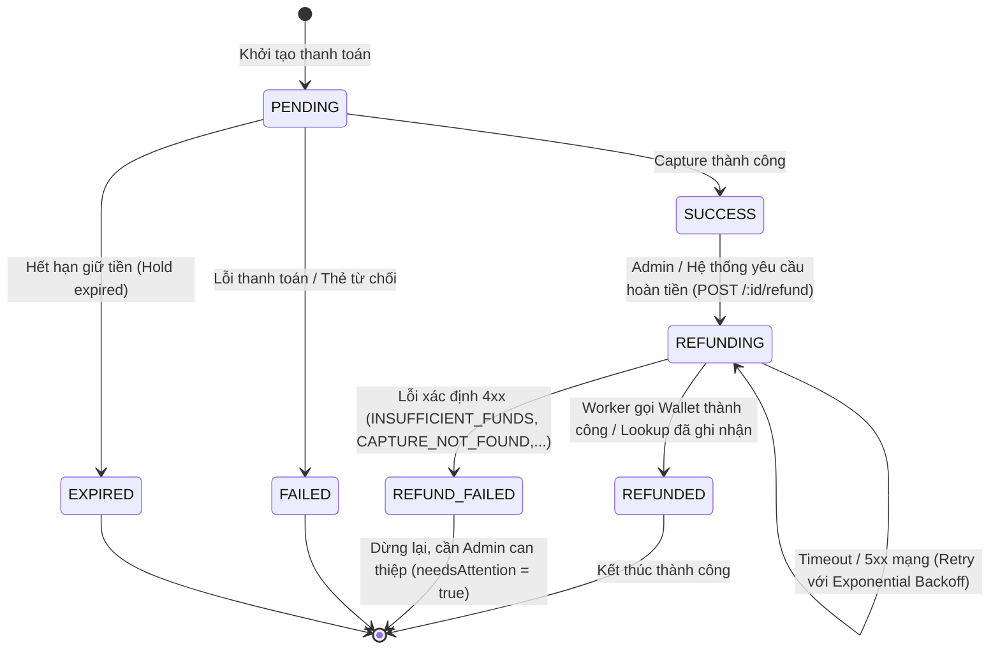
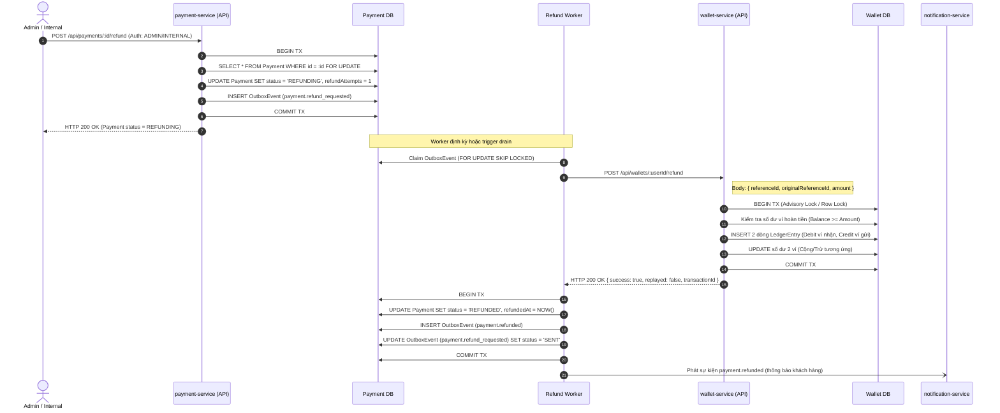
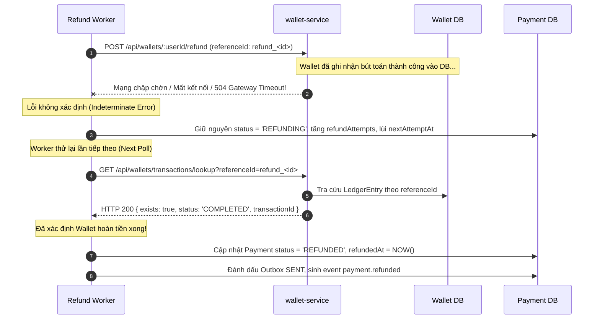
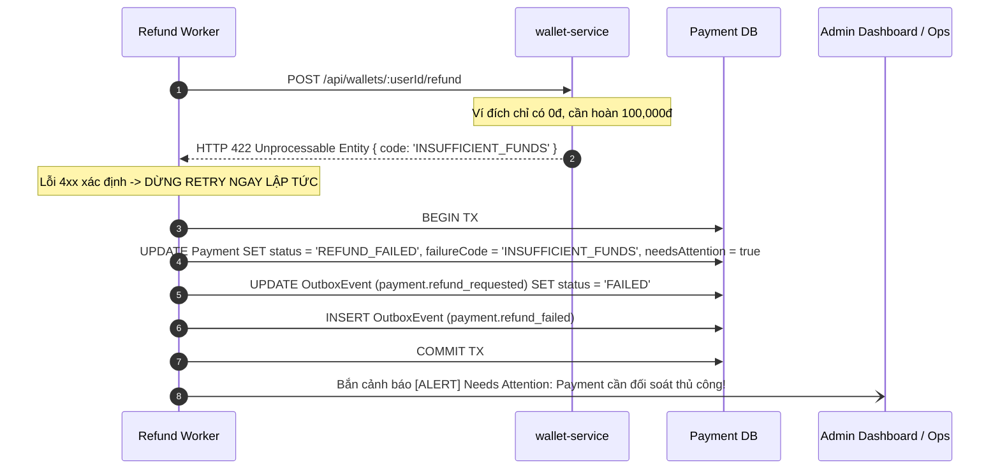

# TÀI LIỆU KIẾN TRÚC SAGA HOÀN TIỀN VÀ MÁY TRẠNG THÁI (K13 REFUND SAGA)
Mã nhiệm vụ: **K13-12**  
Dự án: **FinVault Backend (PTPMHDV_Backend)**  
Dịch vụ tham gia: `payment-service`, `wallet-service`, `notification-service`  
Ngày ban hành: 2026-11-04  

---

## 1. TỔNG QUAN KIẾN TRÚC SAGA HOÀN TIỀN

Saga hoàn tiền (Refund Saga) áp dụng mô hình kết hợp **Transactional Outbox Pattern** với **Orchestrated Saga** nhằm đảm bảo tính nhất quán cuối cùng (Eventual Consistency) và tính toàn vẹn tài chính tuyệt đối giữa `payment-service` và `wallet-service`.

### Các nguyên tắc thiết kế cốt lõi (Core Invariants):
1. **Bảo toàn số dư toàn hệ thống ($\Delta = 0$):** Tiền không tự sinh ra và không tự mất đi. Mọi bút toán hoàn tiền đều là bút toán kép đối ứng (Double-entry book-keeping).
2. **Đối ứng chính xác:**
   - **Giao dịch P2P:** Đảo ngược bút toán: Trừ tiền (Debit) từ ví người nhận cũ và Cộng tiền (Credit) vào ví người gửi ban đầu.
   - **Giao dịch Non-P2P (Bus ticket, Điện, Nước,...):** Đảo ngược bút toán: Trừ tiền (Debit) từ ví hệ thống `SETTLEMENT` và Cộng tiền (Credit) vào ví người thanh toán.
3. **Lũy đẳng tuyệt đối (Strict Idempotency):** Khóa định danh hoàn tiền duy nhất `referenceId = refund_<paymentId>`. Mọi lần gọi lại (retry) đều trả về cùng kết quả mà không tạo thêm bút toán hay thay đổi số dư.
4. **Không tạo tiền khống / Chặn âm ví:** Nếu ví đích không đủ số dư khả dụng (`INSUFFICIENT_FUNDS`), hệ thống từ chối ngay lập tức, chuyển sang `REFUND_FAILED`, kích hoạt cảnh báo quản trị (`needsAttention = true`), không bao giờ sinh ra số dư âm hay tạo tiền khống.
5. **Không hoàn hạn mức ngày (`UserDailyUsage`):** Hạn mức đã sử dụng trong ngày không được hoàn lại khi giao dịch bị hoàn tiền (tuân thủ quy định phòng chống quay vòng hạn mức).

---

## 2. MÁY TRẠNG THÁI THANH TOÁN (PAYMENT STATE MACHINE)



### Bảng ma trận chuyển trạng thái:

| Trạng thái hiện tại | Trigger / Sự kiện | Trạng thái tiếp theo | Điều kiện & Tác vụ kèm theo |
|---|---|---|---|
| `SUCCESS` | Gọi `POST /:id/refund` | `REFUNDING` | Transaction nguyên tử: kiểm tra trạng thái, tăng `refundAttempts = 1`, ghi `OutboxEvent(payment.refund_requested)`. |
| `REFUNDING` | Gọi lại `POST /:id/refund` | `REFUNDING` | Lũy đẳng: trả về HTTP 200 kèm dữ liệu hiện tại, không phát sinh thêm outbox event. |
| `REFUNDED` | Gọi lại `POST /:id/refund` | `REFUNDED` | Lũy đẳng: trả về HTTP 200 kèm dữ liệu hiện tại, không phát sinh thêm outbox event. |
| `REFUNDING` | Worker gọi Wallet trả về 200 | `REFUNDED` | Cập nhật `refundedAt = now()`, sinh sự kiện `payment.refunded`. |
| `REFUNDING` | Worker timeout (504) hoặc 5xx | `REFUNDING` | Giữ nguyên trạng thái, tăng `refundAttempts`, áp dụng exponential backoff, tra cứu lookup trước khi retry. |
| `REFUNDING` | Worker nhận lỗi 4xx xác định | `REFUND_FAILED` | Cập nhật `failureCode`, `failureReason`, bật `needsAttention = true`, outbox `payment.refund_failed`. |
| Khác `SUCCESS` / `REFUNDING` / `REFUNDED` | Gọi `POST /:id/refund` | Không đổi | Từ chối ngay: HTTP 400 (`CANNOT_REFUND_NON_SUCCESSFUL_PAYMENT`). |

---

## 3. SƠ ĐỒ TUẦN TỰ SAGA (MERMAID SEQUENCE DIAGRAMS)

### 3.1. Kịch bản thành công (Happy Path)



---

### 3.2. Kịch bản lỗi mạng, Timeout & Khôi phục sau sự cố (Indeterminate Failure & Recovery)



---

### 3.3. Kịch bản lỗi nghiệp vụ xác định 4xx (Deterministic Failure — Thiếu tiền / Sai lệch)



---

## 4. BẢNG ÁNH XẠ MÃ LỖI (WALLET <-> PAYMENT SERVICE ERROR MAPPING)

| Mã lỗi từ Wallet Service | HTTP Status | Ý nghĩa nghiệp vụ | Phân loại | Hành vi xử lý tại Payment Service | Trạng thái cuối của Payment |
|---|---|---|---|---|---|
| `INSUFFICIENT_FUNDS` | 422 | Ví đích không đủ số dư để hoàn tiền (số dư khả dụng < số tiền hoàn). | Xác định (Deterministic) | **Dừng retry ngay.** Bật `needsAttention = true`, ghi `failureCode` & `failureReason`, sinh sự kiện `payment.refund_failed`. | `REFUND_FAILED` |
| `CAPTURE_NOT_FOUND` | 404 | Không tìm thấy giao dịch Capture gốc của `originalReferenceId`. | Xác định (Deterministic) | **Dừng retry ngay.** Bật `needsAttention = true`, sinh `payment.refund_failed`. | `REFUND_FAILED` |
| `AMOUNT_MISMATCH` | 400 | Số tiền yêu cầu hoàn khác với số tiền đã ghi nhận tại Capture gốc. | Xác định (Deterministic) | **Dừng retry ngay.** Báo lỗi dữ liệu không đồng nhất, yêu cầu kiểm tra lại payload. | `REFUND_FAILED` |
| `ALREADY_REFUNDED` | 409 | Giao dịch Capture gốc đã được hoàn trước đó bằng một `referenceId` khác. | Xác định (Deterministic) | **Dừng retry ngay.** Chống gian lận hoàn đôi nhiều lần. | `REFUND_FAILED` |
| `REFERENCE_ID_REUSED` | 409 | `referenceId` hoàn tiền đã bị dùng cho một giao dịch khác hoặc sai thông số. | Xác định (Deterministic) | **Dừng retry ngay.** Báo lỗi xung đột mã tham chiếu. | `REFUND_FAILED` |
| `WALLET_NOT_FOUND` | 404 | Ví của người dùng không tồn tại trong hệ thống. | Xác định (Deterministic) | **Dừng retry ngay.** Đánh dấu lỗi tài khoản. | `REFUND_FAILED` |
| `GATEWAY_TIMEOUT` / `ECONNREFUSED` / `502` / `503` / `504` | 5xx / Network | Mất kết nối hoặc dịch vụ ví phản hồi quá thời gian chờ (Timeout). | Không xác định (Indeterminate) | **TIẾP TỤC RETRY.** Giữ trạng thái `REFUNDING`. Áp dụng Exponential Backoff. Trước khi gọi lại, bắt buộc gọi API Lookup để kiểm tra ví đã ghi nhận hay chưa. | `REFUNDING` |

---

## 5. HƯỚNG DẪN VẬN HÀNH CHO GIAO DỊCH CẦN CAN THIỆP (`needsAttention = true`)

Khi một giao dịch hoàn tiền chuyển sang `REFUND_FAILED` kèm `needsAttention: true`, hệ thống yêu cầu sự can thiệp của Quản trị viên (Admin Ops) hoặc Kế toán đối soát:

### Quy trình xử lý sự cố (SOP - Standard Operating Procedure):
1. **Lọc danh sách sự cố:**
   ```sql
   SELECT id, user_id, destination_user_id, amount, status, failure_code, failure_reason, updated_at
   FROM "Payment"
   WHERE status = 'REFUND_FAILED' AND needs_attention = true
   ORDER BY updated_at DESC;
   ```
2. **Trường hợp `INSUFFICIENT_FUNDS`:**
   - **Nguyên nhân:** Người nhận (trong giao dịch P2P) đã rút hoặc chuyển hết số tiền nhận được ra khỏi ví trước khi bị hoàn trả.
   - **Giải pháp:**
     - Liên hệ khách hàng / người nhận để thu hồi tiền nợ hoặc yêu cầu nạp tiền vào ví.
     - Sau khi số dư ví đích đủ bù đắp, Admin thực hiện cập nhật lại `needsAttention = false` và gọi lại API hoàn tiền.
     - Hoặc tiến hành cấn trừ công nợ theo chính sách bảo vệ người mua của nền tảng.
3. **Trường hợp `CAPTURE_NOT_FOUND` hoặc `AMOUNT_MISMATCH`:**
   - **Nguyên nhân:** Lệch dữ liệu giữa 2 cơ sở dữ liệu (`payment_service` và `wallet_service`).
   - **Giải pháp:** Kiểm tra log kiểm toán của `wallet-service` và bảng `LedgerEntry` theo `referenceId` để xác định giao dịch capture tương ứng.

---

## 6. MA TRẬN TRUY VẾT KIỂM THỬ (AUTOMATED TEST TRACEABILITY MATRIX)

Toàn bộ các yêu cầu nghiệm thu và kịch bản biên của Saga hoàn tiền đều được bảo đảm bằng bộ kiểm thử tự động (100% pass):

| Kịch bản kiểm thử (Acceptance Scenario) | File kiểm thử | Test Case cụ thể | Trạng thái |
|---|---|---|---|
| **E2E Success (P2P):** Hoàn tiền thành công đảo ngược đối ứng giữa người nhận và người gửi | `services/payment-service/tests/k13-e2e-saga.test.ts` | `K13-11: Luồng E2E thành công P2P và non-P2P, bảo toàn số dư toàn hệ thống` | ✅ PASS |
| **E2E Success (Non-P2P):** Hoàn tiền vé xe buýt từ ví SETTLEMENT về người dùng | `services/payment-service/tests/k13-e2e-saga.test.ts` | `K13-11: Luồng E2E thành công P2P và non-P2P, bảo toàn số dư toàn hệ thống` | ✅ PASS |
| **Nghiệm thu 1:** Worker crash giữa chừng, khi chạy lại chỉ ghi đúng 1 bút toán tại ví, chuyển `REFUNDED` | `services/payment-service/tests/k13-e2e-saga.test.ts` | `K13-11: Nghiệm thu 1 - Giả lập worker chết giữa chừng rồi chạy lại: đúng 1 bút toán hoàn ở wallet` | ✅ PASS |
| **Nghiệm thu 2:** Ví đích thiếu tiền -> 422 `INSUFFICIENT_FUNDS`, `REFUND_FAILED`, cảnh báo Admin, không retry vô hạn, không tạo tiền khống | `services/payment-service/tests/k13-e2e-saga.test.ts` | `K13-11: Nghiệm thu 2 - Ví đích thiếu tiền: REFUND_FAILED kèm lý do, báo Admin, không retry, không tạo tiền` | ✅ PASS |
| **Nghiệm thu 3:** Bảo toàn số dư toàn hệ thống ($\Delta = 0$) trước và sau khi hoàn | `services/payment-service/tests/k13-e2e-saga.test.ts` | `assert.equal(Number(totalAfter) - Number(totalBefore), 0)` | ✅ PASS |
| **Nghiệm thu 4:** Hạn mức ngày (`UserDailyUsage.spentDay`) giữ nguyên không bị hoàn | `services/payment-service/tests/k13-e2e-saga.test.ts` | `K13-11: Hạn mức ngày của người dùng không bị hoàn lại sau khi refund payment` | ✅ PASS |
| **Lũy đẳng Wallet:** Hai request song song cùng `referenceId` chỉ ghi 1 bút toán | `services/wallet-service/tests/k13-refund-entry.test.ts` | `K13-6: Hai request song song cùng referenceId -> đúng một bút toán` | ✅ PASS |
| **Chống hoàn đôi Wallet:** Capture đã hoàn bị chặn bởi `ALREADY_REFUNDED` | `services/wallet-service/tests/k13-refund-entry.test.ts` | `K13-6: ALREADY_REFUNDED khi hoàn một capture đã hoàn bằng referenceId khác` | ✅ PASS |
| **Tra cứu Reference:** Lookup trả đúng trạng thái có sẵn hoặc chưa ghi nhận | `services/wallet-service/tests/k13-refund-entry.test.ts` | `K13-6: Tra cứu theo referenceId - cả trường hợp đã ghi và chưa ghi` | ✅ PASS |
| **Chặn số dư âm Wallet:** Thiếu 0.01 VND bị từ chối chính xác | `services/wallet-service/tests/k13-refund-balance.test.ts` | `K13-5: Thiếu 1 đơn vị nhỏ nhất (0.01 VND) - bị chặn chính xác` | ✅ PASS |
| **Worker Retry & Lookup:** Timeout giữ `REFUNDING`, tra cứu lookup thành công chuyển `REFUNDED` | `services/payment-service/tests/k13-refund-worker-retry.test.ts` | `K13-9: Timeout/5xx từ wallet giữ trạng thái REFUNDING, tăng refundAttempts và backoff` | ✅ PASS |
| **Khởi tạo Saga nguyên tử:** Khởi tạo `POST /:id/refund` chuyển `REFUNDING` và outbox | `services/payment-service/tests/k13-refund-init.test.ts` | `K13-7: Khởi tạo saga hoàn tiền thành công chuyển sang REFUNDING và ghi outbox event` | ✅ PASS |
| **Phân quyền Route Refund:** User bị 403, ADMIN và INTERNAL được phép | `services/payment-service/tests/k13-refund-init.test.ts` | `K13-7: Route POST /:id/refund phân quyền - user thường 403, ADMIN và INTERNAL được phép` | ✅ PASS |
