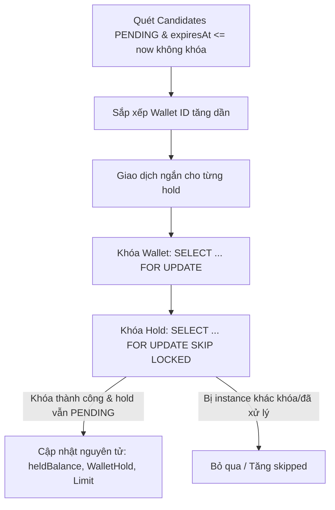
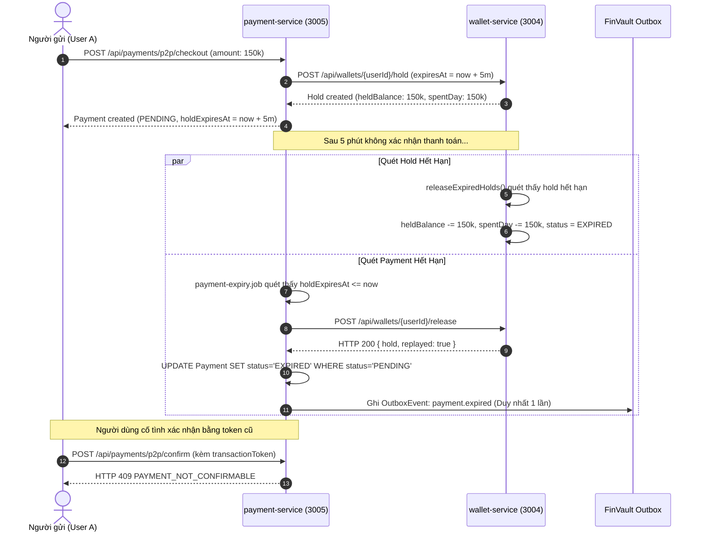

# TÀI LIỆU KỸ THUẬT K14: GIA CỐ JOB GIẢI PHÓNG HOLD HẾT HẠN (WALLET & PAYMENT)

Tài liệu này tổng hợp toàn bộ thiết kế, triển khai, cấu hình và cơ chế vận hành của Nhiệm vụ K14 nhằm củng cố tính chịu lỗi, chống xung đột tương tranh và bảo toàn toàn vẹn số dư cho hệ thống ví và thanh toán `FinVault`.

---

## 1. Kiến Trúc & Cơ Chế Claim SKIP LOCKED

### 1.1. Thứ tự khóa nhất quán (Lock Ordering)
Để loại trừ hoàn toàn nguy cơ Deadlock giữa các tiến trình chạy song song (`createHold`, `captureHold`, `releaseHold`, và job quét `releaseExpiredHolds`), hệ thống tuân thủ nghiêm ngặt quy tắc:
$$\text{Wallet (khóa theo ID tăng dần)} \longrightarrow \text{WalletHold}$$



### 1.2. Cơ chế 2 giai đoạn (2-Phase Claim)
1. **Giai đoạn 1 (Non-locking Read)**: Quét danh sách hold ứng viên không khóa:
   ```sql
   SELECT id, "walletId", "referenceId" 
   FROM "WalletHold" 
   WHERE status = 'PENDING' AND "expiresAt" <= NOW() 
   ORDER BY "expiresAt" ASC, id ASC 
   LIMIT $batchSize;
   ```
2. **Giai đoạn 2 (Short Transaction per Hold)**: Với từng ứng viên:
   - Khóa ví: `SELECT id FROM "Wallet" WHERE id = $walletId FOR UPDATE;`
   - Khóa hold với `SKIP LOCKED`: 
     ```sql
     SELECT id, "walletId", amount, status, "createdAt" 
     FROM "WalletHold" 
     WHERE id = $holdId::uuid AND status = 'PENDING' AND "expiresAt" <= NOW() 
     FOR UPDATE SKIP LOCKED;
     ```
   - Cập nhật điều kiện nguyên tử trong 1 transaction:
     - `Wallet`: `heldBalance -= amount` (Bảo vệ `heldBalance >= 0`, ném `NEGATIVE_HELD_BALANCE` nếu vi phạm).
     - `WalletHold`: `UPDATE ... SET status = 'EXPIRED' WHERE id = $holdId AND status = 'PENDING'`.
     - `UserDailyUsage`: Hoàn `spentDay -= amount` theo đúng ngày VN (UTC+7) lúc tạo hold (Bảo vệ `spentDay >= 0`, ném `NEGATIVE_SPENT_DAY` nếu vi phạm).
     - **Tuyệt đối không sinh bút toán `LedgerEntry`** (hết hạn chỉ giải phóng số dư treo, không làm dịch chuyển quyền sở hữu tiền).

---

## 2. Cấu Hình Môi Trường (Environment Variables)

Các tham số quét định kỳ và trần batch được cấu hình linh hoạt qua biến môi trường (có giá trị mặc định an toàn):

| Tên biến | Service | Mặc định | Mô tả |
| :--- | :--- | :--- | :--- |
| `WALLET_HOLD_EXPIRY_INTERVAL_MS` | wallet-service | `10000` (10s) | Chu kỳ kích hoạt vòng lặp quét hold hết hạn |
| `WALLET_HOLD_EXPIRY_BATCH_SIZE` | wallet-service | `50` | Số lượng hold tối đa được quét và xử lý trong một lượt |
| `PAYMENT_EXPIRY_INTERVAL_MS` | payment-service | `30000` (30s) | Chu kỳ quét thanh toán PENDING quá hạn |
| `PAYMENT_EXPIRY_BATCH_SIZE` | payment-service | `50` | Số lượng payment tối đa xử lý mỗi chu kỳ |

---

## 3. Định Dạng Log Có Cấu Trúc (Structured Logging)

### 3.1. Log tổng kết chu kỳ (Một dòng JSON)
Cuối mỗi lượt quét, sweeper ghi một dòng log JSON chuẩn định dạng:
```json
{
  "instanceId": "wallet-worker-01",
  "scanned": 9,
  "released": 9,
  "skipped": 0,
  "errors": 0,
  "durationMs": 142
}
```

### 3.2. Log lỗi chi tiết từng hold
Nếu có hold gặp lỗi cục bộ (ví dụ lỗi dữ liệu không hợp lệ), lỗi được ghi nhận có cấu trúc và không làm sập toàn bộ chu kỳ:
```json
{
  "event": "HOLD_RELEASE_ERROR",
  "instanceId": "wallet-worker-01",
  "holdId": "7d38f196-f1a6-48ba-8b22-a02700498f64",
  "walletId": 1160,
  "code": "USAGE_ROW_NOT_FOUND",
  "message": "No usage record found for user cdf4f9e5-c243-4559-91a2-a4a580161065 on day 2026-11-05"
}
```

---

## 4. Hợp Đồng Lũy Đẳng (Idempotency Contract)

### 4.1. `releaseHold`
- Khi `releaseHold` được gọi với một hold đã chuyển sang `EXPIRED` (do sweeper ví nhả trước) hoặc `RELEASED`:
  - **Mã phản hồi**: HTTP 200 OK.
  - **Dữ liệu trả về**: `{ hold: WalletHold, replayed: true }`.
  - **Tác dụng phụ**: Không trừ thêm `heldBalance`, không hoàn lại hạn mức lần 2, không sinh lỗi 4xx/5xx làm gián đoạn client.

### 4.2. `captureHold`
- Khi `captureHold` được gọi với một hold đã bị sweeper nhả (`status === 'EXPIRED'`):
  - **Mã phản hồi**: HTTP 409 Conflict.
  - **Mã lỗi nghiệp vụ**: `HOLD_EXPIRED`.
  - Giữ nguyên hợp đồng hiện hữu, không hồi quy lỗi.

---

## 5. Luồng Hết Hạn P2P Quá 5 Phút (E2E P2P Expiry Flow)



---

## 6. Công Cụ & Script Kiểm Tra Bất Biến (Invariant Checker)

File script: [`scripts/check-k14-invariants.cjs`](file:///d:/Projects/PTPMHDV_Backend/PTPMHDV_Backend/scripts/check-k14-invariants.cjs)

### Chức năng:
1. Chạy độc lập trên cơ sở dữ liệu `wallet_service`:
   ```bash
   node scripts/check-k14-invariants.cjs
   ```
2. Kiểm tra:
   - $\sum \text{balance}(\text{USER}) + \sum \text{balance}(\text{SYSTEM})$ bảo toàn.
   - Không có ví `USER` nào bị âm `balance`.
   - Không có ví nào (bất kể `USER` hay `SYSTEM`) bị âm `heldBalance`.
   - Không có bản ghi hạn mức `UserDailyUsage` nào bị âm `spentDay`.
   - Tổng số bút toán `LedgerEntry` không đổi ($\Delta = 0$).
   - In kết quả `ĐẠT (PASS)` hoặc `KHÔNG ĐẠT (FAIL)` kèm chênh lệch.

---

## 7. Các Điểm Ngoài Phạm Vi (Out of Scope)
- **Không bổ sung event liên service trực tiếp từ wallet sang payment**: Nhằm giữ vững tính độc lập microservices và không làm phình outbox của wallet-service, `payment-expiry.job` tiếp tục chịu trách nhiệm chính về vòng đời thanh toán và xuất bản sự kiện `payment.expired`.
- **Không can thiệp logic Saga hoàn tiền K13**: Các kịch bản hoàn tiền P2P/Non-P2P sau khi thanh toán thành công thuộc phạm vi K13 và hoàn toàn độc lập với cơ chế hold expiry của K14.
