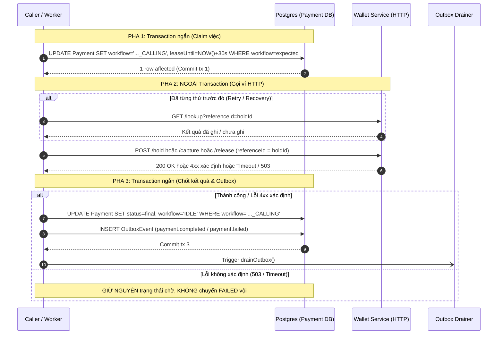

# THIẾT KẾ K16: TÁCH HTTP KHỎI TRANSACTION TRONG P2PSERVICE

## 1. Tóm tắt 25 dòng (Phân tích thực trạng và mốc kiểm chứng)
1. **(a) Mốc A1 & A2:** A1 hiện nằm tại `services/wallet-service/tests/concurrency.ts` (`npm --prefix services/wallet-service run test:concurrency`), chạy trực tiếp qua `ledgerService.transfer` nên **A1 không phủ P2pService** (kết quả mốc: 1 SUCCESS, 19 FAILED, số dư còn 40.000đ). Biến thể **A1-P2P** được bổ sung ở Commit 1 (20 checkout+confirm song song qua P2pService). A2 (bấm 2 lần cùng Idempotency-Key) chạy qua `p2p.checkout`, mốc: 1 payment duy nhất, lần 2 trả `replayed: true`.
2. **(b) completeHold & resume hiện tại:** Gọi HTTP trong `prisma.$transaction(..., { maxWait: 15000, timeout: 25000 })` gây giữ kết nối DB và khóa hàng tối đa 25s:
   - `p2p.service.ts:77`: `wallet.createHold` nằm trong transaction của `completeHold`.
   - `p2p.service.ts:113`: `wallet.captureHold` nằm trong transaction của `resume`.
   - `p2p.service.ts:124`: `wallet.releaseHold` nằm trong transaction của `resume`.
   - `p2p.service.ts:127`: `wallet.captureHold` bù trừ nằm trong transaction của `resume`.
   - `p2p.service.ts:145`: `wallet.releaseHold` nằm trong transaction của `cancel`.
   - Chỗ ghi `jti` và chuyển `CONFIRMING` nằm ở `p2p.service.ts:98-99` trong transaction của `confirm` (bất biến: giữ nguyên cùng pha 1).
3. **(c) Các nơi khác gọi ví trong transaction (Ngoài phạm vi K16):**
   - `payment.service.ts`: Các hàm thanh toán merchant/thẻ/vé (dòng 46, 142, 203, 294, 345, 385, 456, 506, 552, 592, 734, 793, 799) thuộc luồng non-P2P cũ, giữ nguyên báo cáo, không sửa ở K16.
   - `topup.service.ts`: Nạp tiền thẻ cào / ngân hàng, giữ nguyên.
   - `refund.worker.ts`: Worker hoàn tiền (đã tách pha tra cứu và hoàn tiền từ K13).
   - `payment-expiry.job.ts`: Bot quét hết hạn (đã gọi ví ngoài transaction từ K14).
4. **(d) Workflow & cơ chế claim hiện tại:** Bảng `Payment` có cột `workflow` kiểu chuỗi (`IDLE`, `HOLDING`, `CONFIRMING`, `RELEASING`). `p2p.recover()` quét các payment `PENDING` có `workflow !== 'IDLE'` để tiếp tục xử lý.
5. **(e) Idempotency & Lookup của Wallet:** `wallet-service` ĐÃ hỗ trợ đầy đủ lũy đẳng theo `referenceId` cho hold, capture, release (`sourceWalletId_referenceId`) và ĐÃ có endpoint tra cứu `GET /api/wallets/transactions/lookup?referenceId=...` (K13). `WalletClient` đã có hàm `lookupTransaction(referenceId)`.
6. **(f) Phân loại lỗi & Timeout:** `WalletClient` sử dụng `AbortSignal.timeout(5000)`. Lỗi timeout/mạng bắn `DomainException(503, 'WALLET_UNAVAILABLE')`. Lỗi HTTP 4xx trả về `DomainException(status, code, message)`.

---

## 2. Bảng Trạng Thái & Bước Workflow Mới

| Bước Workflow | Trạng Thái Payment | Ý Nghĩa Nghiệp Vụ | Ai Ghi (Pha) | Điều Kiện Chuyển Tiếp | Cách Recover Khi Worker Chết |
| :--- | :--- | :--- | :--- | :--- | :--- |
| `HOLDING` | `PENDING` | Khởi tạo checkout, chuẩn bị giữ tiền | `checkout` (Insert) | Tạo mới với idempotencyKey | Worker quét thấy gọi `completeHold` |
| `HOLD_CALLING` | `PENDING` | **Đã nhận việc (Claimed)**, đang gọi `wallet.createHold` | `completeHold` (Pha 1) | `workflow='HOLDING' AND idempotencyStatus='PROCESSING'` | Lease hết hạn / recover tra cứu hoặc gọi lại với cùng `holdId` |
| `IDLE` | `PENDING` | Giữ tiền ví thành công, chờ người dùng xác nhận | `completeHold` (Pha 3) | `createHold` thành công | Khách hàng bấm confirm hoặc cron quét hết hạn |
| `CONFIRMING` | `PENDING` | Token hợp lệ, đã ghi `jti`, sẵn sàng trừ tiền | `confirm` (Pha 1) | `workflow='IDLE' AND status='PENDING'` | Gọi `resume(id)` |
| `CAPTURE_CALLING` | `PENDING` | **Đã nhận việc**, đang gọi `wallet.captureHold` | `resume` (Pha 1) | `workflow='CONFIRMING' OR workflow='CAPTURE_CALLING'` | Tra cứu ví bằng `holdId`: nếu đã ghi -> Pha 3 SUCCESS; nếu chưa -> gọi lại |
| `RELEASING` | `PENDING` | Capture thất bại xác định, chuẩn bị nhả hold | `resume` (Pha 3) | Capture trả 4xx `HOLD_EXPIRED`/`HOLD_NOT_CAPTURABLE` | Worker gọi `resume` tiếp tục nhả hold |
| `RELEASE_CALLING` | `PENDING` | **Đã nhận việc**, đang gọi `wallet.releaseHold` | `resume` (Pha 1) | `workflow='RELEASING' OR workflow='RELEASE_CALLING'` | Gọi lại `releaseHold` với `holdId` lũy đẳng |
| `CANCEL_CALLING` | `PENDING` | **Đã nhận việc**, đang gọi `wallet.releaseHold` để hủy | `cancel` (Pha 1) | `status='PENDING' AND workflow IN ('IDLE', 'HOLDING')` | Gọi lại `releaseHold` với `holdId` |
| `IDLE` | `SUCCESS` | Giao dịch P2P hoàn tất thành công | `resume` (Pha 3) | Capture ví thành công | Trạng thái cuối, không recover |
| `IDLE` | `FAILED` / `EXPIRED` | Giao dịch thất bại / hết hạn, hold đã nhả | `resume` / `cancel` (Pha 3) | Release ví thành công | Trạng thái cuối, không recover |

---

## 3. Ranh Giới 3 Pha Chi Tiết



### 3.1. `completeHold(id)`:
* **Pha 1 (Transaction ngắn):**
  * Conditional update:
    ```sql
    UPDATE "Payment"
    SET "workflow" = 'HOLD_CALLING', "workerLeaseUntil" = NOW() + INTERVAL '30 seconds', "updatedAt" = NOW()
    WHERE "id" = $id AND "status" = 'PENDING' AND "workflow" IN ('HOLDING', 'HOLD_CALLING') AND "idempotencyStatus" = 'PROCESSING'
    ```
  * Commit transaction. Nếu 0 dòng bị ảnh hưởng, đọc lại payment: nếu `COMPLETED` thì trả kết quả; nếu `FAILED` thì trả lỗi 409 `CHECKOUT_FAILED`.
* **Pha 2 (NGOÀI Transaction):**
  * `referenceId = payment.holdId` (ổn định duy nhất xuyên suốt).
  * Gọi `this.wallet.createHold(...)`.
  * Phân loại:
    * Thành công: `walletOk = true`.
    * Lỗi 4xx xác định (ví dụ `INSUFFICIENT_FUNDS`, `DAILY_LIMIT_EXCEEDED`, 400..422): `walletOk = false`, `failureCode = error.code`.
    * Lỗi không xác định (503, ECONNREFUSED, timeout): Giữ `HOLD_CALLING`, ném 503 `WALLET_UNAVAILABLE`.
* **Pha 3 (Transaction ngắn):**
  * Nếu `walletOk`:
    ```sql
    UPDATE "Payment"
    SET "workflow" = 'IDLE', "idempotencyStatus" = 'COMPLETED', "updatedAt" = NOW()
    WHERE "id" = $id AND "workflow" = 'HOLD_CALLING'
    ```
  * Nếu 4xx xác định:
    ```sql
    UPDATE "Payment"
    SET "status" = 'FAILED', "workflow" = 'IDLE', "idempotencyStatus" = 'FAILED', "failureReason" = $failureCode, "updatedAt" = NOW()
    WHERE "id" = $id AND "workflow" = 'HOLD_CALLING'
    ```
    Ghi `PaymentHistory` tương ứng. Commit transaction.

### 3.2. `confirm(id, userId, token)` & `resume(id)`:
* **Confirm (Pha 1 Transaction):**
  * Khóa dòng payment, xác thực token chữ ký và quyền sở hữu.
  * **BẤT BIẾN:** Kiểm tra và ghi `jti` vào bảng `UsedTransactionToken` (UNIQUE) **TRONG CÙNG** transaction với việc chuyển `workflow = 'CONFIRMING'` (hoặc `'CAPTURE_CALLING'`).
  * Commit transaction. Sau đó gọi `resume(id)` bên ngoài transaction.
* **Resume (3 Pha):**
  * **Pha 1 (Tx ngắn):**
    * UPDATE có điều kiện: `workflow = 'CONFIRMING'` -> `workflow = 'CAPTURE_CALLING'`; hoặc `workflow = 'RELEASING'` -> `workflow = 'RELEASE_CALLING'`. Commit tx.
  * **Pha 2 (NGOÀI Tx):**
    * Nếu `CAPTURE_CALLING`:
      * Nếu recover hoặc có nguy cơ gọi lặp: gọi `wallet.lookupTransaction(payment.holdId)`. Nếu ví báo đã `COMPLETED` -> đi thẳng tới Pha 3 SUCCESS.
      * Gọi `this.wallet.captureHold(payment.userId, payment.holdId)`.
      * Nếu lỗi 4xx (`HOLD_EXPIRED`, `HOLD_NOT_CAPTURABLE`): chuyển sang cần nhả `RELEASING` với `failureReason = 'HOLD_EXPIRED'`.
      * Nếu lỗi 4xx khác: chuyển `RELEASING` với `failureReason = 'CAPTURE_FAILED'`.
      * Nếu lỗi không xác định (timeout/503): giữ nguyên `CAPTURE_CALLING`, ném 503 để worker/khách hàng tra cứu sau.
    * Nếu `RELEASE_CALLING`:
      * Gọi `this.wallet.releaseHold(payment.userId, payment.holdId)`.
      * Nếu ví báo `HOLD_ALREADY_CAPTURED`: gọi capture và chuẩn bị chốt SUCCESS.
  * **Pha 3 (Tx ngắn):**
    * Cập nhật trạng thái cuối:
      * Thành công: `status = 'SUCCESS'`, `workflow = 'IDLE'`.
      * Thất bại / Hết hạn: `status = ('HOLD_EXPIRED' ? 'EXPIRED' : 'FAILED')`, `workflow = 'IDLE'`.
    * Ghi `PaymentHistory` và `OutboxEvent` (`payment.completed` hoặc `payment.failed`) **TRONG CÙNG** transaction này. Commit tx.
    * Kích hoạt `drainOutbox()` bất đồng bộ.

---

## 4. Ma Trận Xử Lý Lỗi

| Lỗi Khi Gọi Ví | Phân Loại | Hành Động Tại Pha 2 | Hành Động Tại Pha 3 / Sau Đó |
| :--- | :--- | :--- | :--- |
| **200 OK** | Thành công | Đánh dấu thành công | Chốt trạng thái tương ứng (`IDLE`/`SUCCESS`), ghi Outbox |
| **400/404/422/INSUFFICIENT_FUNDS** | 4xx xác định | Đánh dấu thất bại nghiệp vụ | Chốt `FAILED`, hoàn nhả hold nếu cần, ghi Outbox |
| **HOLD_EXPIRED / HOLD_NOT_CAPTURABLE** | 4xx xác định | Đánh dấu cần release hold | Chốt `EXPIRED` hoặc `FAILED`, ghi Outbox |
| **HOLD_ALREADY_CAPTURED** | 4xx đặc biệt | Thử gọi capture hoặc tra cứu | Chốt `SUCCESS` nếu capture hợp lệ |
| **Timeout (AbortError 5s)** | **Không xác định** | **KHÔNG** release, **KHÔNG** chốt FAILED | Giữ nguyên bước `..._CALLING`, ném 503, để worker tra cứu lại qua lookup |
| **503 WALLET_UNAVAILABLE** | **Không xác định** | **KHÔNG** release, **KHÔNG** chốt FAILED | Giữ nguyên bước `..._CALLING`, ném 503 |
| **Worker sập nguồn (Kill/Crash)** | Gián đoạn tiến trình | Giữ nguyên bước `..._CALLING` trong DB | Khi khởi động lại, `recover()` kiểm tra lease và tra cứu ví để tiếp tục |

---

## 5. Bảng Mốc Kiểm Chứng Nghiệm Thu (Trước Refactor)

Chạy thực tế trên nhánh `feat/k16-p2p-no-http-in-tx` (Commit `148b586`):

| Mã Kịch Bản | Mô Tả Nghiệp Vụ | Lệnh Chạy / Test File | Kết Quả Mốc (Trước Refactor) | Đạt / Ghi Chú |
| :--- | :--- | :--- | :--- | :--- |
| **A1** | Chuyển tiền song song: 20 request x 60k trên ví 100k | `npm --prefix services/wallet-service run test:concurrency` | **1 SUCCESS, 19 FAILED**, số dư cuối = **40.000đ** | **ĐẠT** *(A1 gọi thẳng ví, thêm A1-P2P ở Commit 1)* |
| **A2** | Double click: gửi 2 checkout cùng Idempotency-Key | `p2p.checkout` (`p2p.service.ts:61`) | **1 payment tạo ra**, lần 2 trả `replayed: true` | **ĐẠT** |
| **A1-P2P** *(Bổ sung)* | 20 checkout + confirm song song qua P2pService (ví 100k, mỗi đơn 60k) | Đóng gói trong `k16-transaction-guard.test.ts` (Commit 1) | **1 SUCCESS, 19 FAILED/REJECTED**, số dư ví = 40.000đ, tổng bảo toàn = 0 | Sẽ chạy lấy mốc tại Commit 1 trước khi sửa code |
| **A4** | Tái sử dụng transaction token (jti duplicate) | `p2p.confirm` (`k14-p2p-expiry-e2e.test.ts`) | Lần 1 SUCCESS, lần 2 **409 TXN_TOKEN_REUSED**, đúng 1 cặp bút toán | **ĐẠT** |
| **S8** | Capture lỗi | `p2p.resume` | Payment chuyển FAILED, hold được release, người gửi không bị trừ kép | **ĐẠT** |
| **S15** | Idempotency-Key trùng lặp | `p2p.checkout` | Cùng paymentId, đúng một hold được tạo | **ĐẠT** |
| **Concurrency Wallet** | Deadlock & Parallel Holds | `services/wallet-service/tests/concurrency.ts` | Deadlock test: PASS; Parallel holds: 1 SUCCESS, 1 FAILED, held = 60k | **ĐẠT** (100%) |
